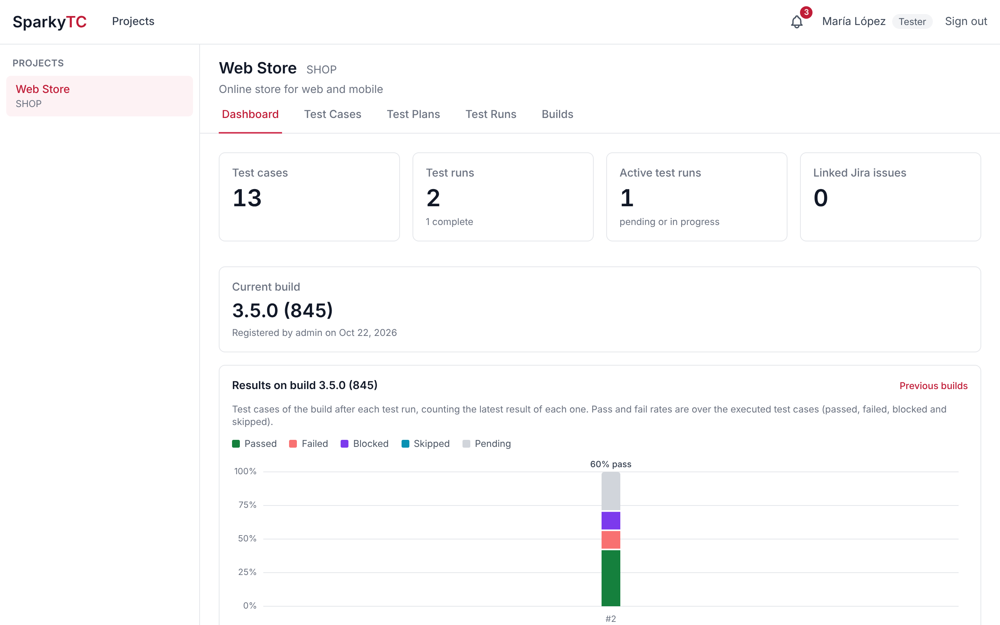
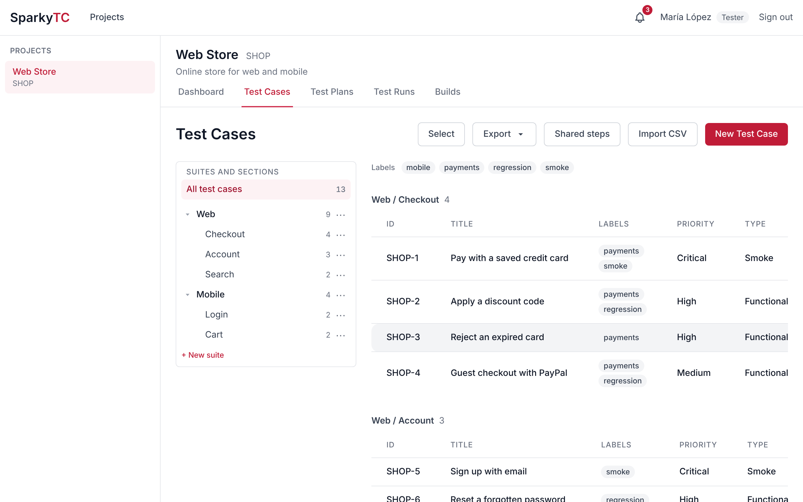
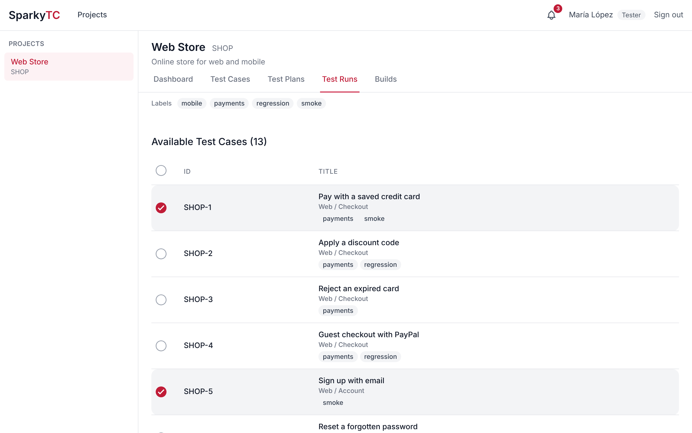
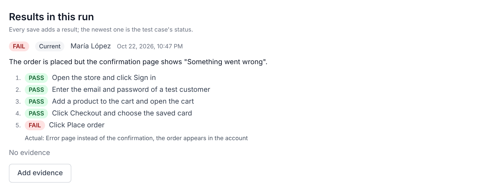
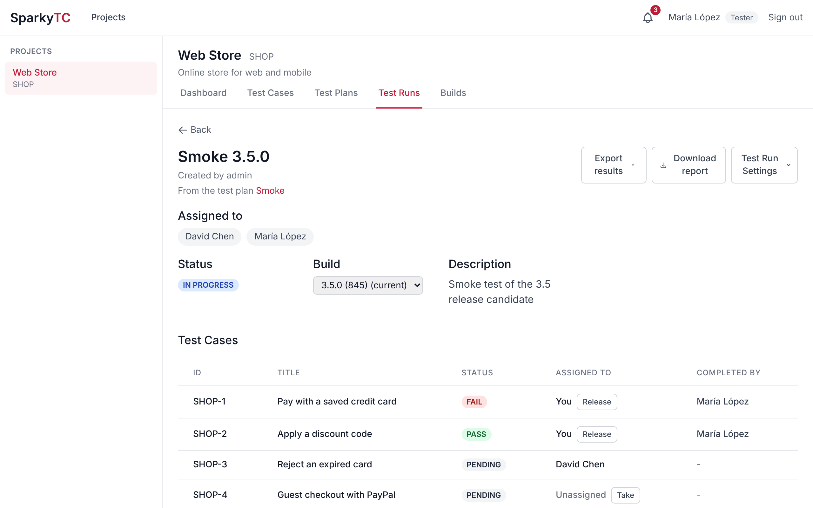
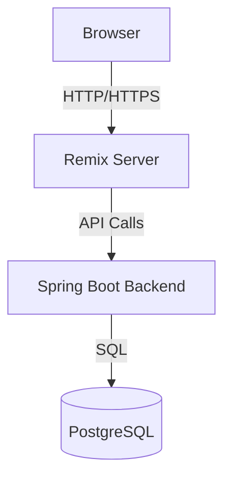

# SparkyTC Test Management Platform


SparkyTC is a modern test case management platform that helps teams organize, track, and execute their testing efforts efficiently. Built on top of enterprise-grade open source tools, SparkyTC provides a robust and reliable solution for managing and executing test cases.

SparkyTC is based on [Cherry](https://github.com/bennettadam/cherry) by Adam Bennett and is distributed under the Apache License 2.0 (see [LICENSE](./LICENSE)). It has been modified to add CSV import, media attachments, Jira integration and user accounts, among other changes.

## Features

### Project Management



Manage your team's projects and test cases in a structured way.

### Test Case Creation and Organization



Create and organize your test cases for each of your projects.

### Test Runs

#### Creation



Filter and select the test cases you want to run.

#### Test Case Results



Document the results of each test case with a status and any notes or observations.

#### Test Run Progress



View the progress of your test run and see the results of each test case.

### Additional Features

-  Custom property configuration for test cases
-  Batch import of test cases from a `.csv` file (see below)
-  Images and videos attached to test cases, visible while executing a test run
-  Links inside test case descriptions, instructions and properties are clickable and open in a new tab
-  Edit a test case's title, description and instructions from within a test run, optionally applying the changes to the original test case
-  Jira integration: create bugs in Jira from failed test cases, link existing issues and see their status, and close or reopen them when recording a result (see below)
-  User accounts with Tester and Admin roles, and a record of who created, updated and executed each test case (see below)
-  Home dashboard per project with test case and test run summaries, and a default project opened after signing in
-  Per-project visibility: admins choose which projects each tester can see
-  Light, dark or system theme, chosen by each user from their account page
-  Test run responsibilities: assign test runs to users, testers take test cases so work isn't duplicated, and each result shows who completed it
-  In-app notifications when you are assigned to a test run or a test run in your projects is completed, configurable from the account page; read notifications can be deleted one by one or all at once with **Clear read**
-  Per-project Jira settings: disable issue creation, create issues manually or automatically when a failure is saved, and pick the Jira space and issue type from lists; similar existing issues are suggested before creating a new one
-  Builds per project: admins register the build being tested, the newest one is shown on the dashboard, and each test run records the build it tests (see below)
-  Build results: the dashboard charts the current build's results after each of its test runs as stacked bars (passed, failed, skipped and pending), and the **Builds** tab compares the results of every build
-  Optional time tracking per test run: testers time each test case with a start/pause button or type how long it took, the run shows the total and a breakdown by day, and the dashboard shows the time spent on the current build (see below)
-  Works on phones and tablets: the menu and project list fold away, and tables become cards

### Importing test cases from CSV

From a project's test case list, click **Import CSV**. The first row of the file must contain the column names:

| Column              | Required | Notes                                                                                                 |
| ------------------- | -------- | ----------------------------------------------------------------------------------------------------- |
| `Title`             | Yes      |                                                                                                       |
| `Description`       | No       |                                                                                                       |
| `Test Instructions` | No       | Line breaks are kept when the value is quoted                                                         |
| _Property title_    | No       | One column per property (e.g. `Priority`, `Type`). Empty required properties use their default value |

Comma, semicolon and tab separated files are supported, and column names and select options are matched case-insensitively. Use **Download template** on the import page to get a file with the columns for your current properties. The rows are previewed and validated before importing, and the import is all-or-nothing.

### Test case attachments

Images and videos are stored in the database. The maximum upload size can be configured with the `ATTACHMENT_MAX_FILE_SIZE` (default `100MB`) and `ATTACHMENT_MAX_REQUEST_SIZE` (default `200MB`) environment variables of the backend service.

These features require database schema version `0.0.11`. Existing installations must run the backend once with `DATABASE_MIGRATION_MODE=MIGRATE` after updating.

### User accounts

Everyone signs in with their own account. There are two roles:

-  **Tester**: create, edit and import test cases, run test runs, add images and videos, and create or link Jira issues.
-  **Admin**: everything a tester can do in every project, plus creating projects, managing users (**Users** page), configuring properties, and deleting test cases and test runs.

Deleting a test case that test runs already used archives it instead: it leaves the test case list, the test case selector and the dashboard counts, while those test runs keep its result, marked **Archived**. Test cases no test run used are deleted.

Testers only see the projects assigned to them: on the **Users** page, click a tester's project count in the **Projects** column and check the projects they should see. Admins always see every project. Testers that existed before project visibility was added keep access to all the projects that existed at that time.

The account set in `ADMIN_USERNAME` is the **super admin**: an admin that is also the only account that can reset other users' passwords, and the only one that can change the super admin account itself. Other admins can still create users, make other users admins and deactivate accounts. The super admin isn't offered when assigning test runs or test cases.

The super admin account is created when the backend starts if it doesn't exist yet, so add these variables to the `.env` file before the first start, then sign in and create the rest of the accounts from the **Users** page. On existing installations, the account with that username becomes the super admin on the next start.

```
ADMIN_USERNAME=<username>
ADMIN_PASSWORD=<at least 8 characters>
SESSION_SECRET=<long random string, e.g. the output of: openssl rand -hex 32>
```

`ADMIN_PASSWORD` is only used to create the account. If the super admin forgets their password, start the backend once with `ADMIN_PASSWORD_RESET=true` to set it back to `ADMIN_PASSWORD`, then remove the variable so it isn't reset on every restart.

`SESSION_SECRET` signs the session cookie of the client service. If it isn't set a random one is used and everyone is signed out whenever the client restarts. Sessions last 7 days. Set `COOKIE_SECURE=true` once the application is served over HTTPS.

Users can change their password from their account page (click their name in the top bar). The super admin can reset passwords and admins can deactivate accounts, both of which sign the user out immediately.

### Builds

Admins register each build of the product under test from the **Current build** card of the project dashboard, or from the **Builds** section of the project's **Settings** tab, where builds can also be renamed or deleted (builds used by a test run can't be deleted). Build numbers are free text, e.g. `2.3.1 (4512)`, and the newest one is the project's current build.

Each build's results count the latest executed result of each test case across the build's test runs, so a failure fixed in a later run counts as passed. Pass and fail rates are over the executed test cases (passed, failed and skipped). The dashboard charts the current build after each of its test runs, and the **Builds** tab lists every build with its rates, its test runs and a chart comparing builds.

When creating a test run the current build is preselected.

### Time tracking

Check **Track time spent testing** when creating a test run (or later in **Edit Test Run**) to time its test cases:

-  On a test case of the run, **Start timer** starts counting the time; it can be paused and resumed as often as needed. The timer is stored on the server, so it keeps running when the tester changes page or closes the browser, and each tester has one running timer at a time: starting another test case's timer pauses the previous one. Recording the result stops the timer.
-  If the timer wasn't used for a test case, the tester can type how many minutes testing took when recording the result.
-  The test run page shows the total time, a breakdown by day and the time of each test case. Once the run is complete or aborted, admins can **Edit total**, which replaces the tracked time (and hides its breakdown) until they choose **Use tracked time**.
-  The dashboard shows the time spent on the current build's test runs that track time, and the **Builds** tab shows it for each build. Testers pick one of the registered builds, and anyone working on the run can change it while it's open. The build is sent with the Jira issues created from the run.

### Jira integration

SparkyTC can create a bug in Jira Cloud from a failed test case run, link existing issues to a test case, and show the current status of the linked issues. Add these variables to the `.env` file of the backend service:

```
JIRA_BASE_URL=https://your-site.atlassian.net
JIRA_EMAIL=user@example.com
JIRA_API_TOKEN=<api token>
JIRA_PROJECT_KEY=SCRUM   # default space (project) where bugs are created
JIRA_ISSUE_TYPE=Error    # default issue type name used for bugs
```

API tokens are created at https://id.atlassian.com/manage-profile/security/api-tokens and act with the permissions of the account that created them (it needs Browse projects, Create issues and Link issues). Tokens expire, so renew them when SparkyTC reports that Jira rejected the credentials. The integration is disabled while any of the first three variables is empty.

-  To report a bug, mark a test case as **Fail** during a test run and click **Create bug in Jira**. The form is pre-filled from the test case: the summary from the title, the steps from the test instructions, the expected result from the `Expected Result` property, the build number from the test run's build (or the `Build Number` property when the run has none), and the actual result from the run notes.
-  Images and videos are **never uploaded to Jira**, so they don't use its storage quota. The issue description links to them in SparkyTC instead, and a link back to the test case is added to the issue.
-  When recording a **Pass**, the tester can close the linked issues that aren't done; when recording a **Fail**, they can reopen the linked issues that are done and optionally assign them to someone else so they find out (see below).
-  The links use the address you open SparkyTC with (e.g. `http://192.168.1.20:3000`). Set `SPARKYTC_PUBLIC_URL` in the client service to override it, for example when a domain is added.

## Architecture Overview

SparkyTC follows a three-tier architecture:

1. **Client service (Remix + React)**

   -  Handles UI rendering and client-side state
   -  Uses Remix for server-side rendering and data loading
   -  Communicates with backend via REST API

2. **Backend service (Spring Boot)**

   -  Implements business logic and API endpoints
   -  Manages data persistence operations

3. **Database (PostgreSQL)**

   -  Stores application data



## Deploying SparkyTC to production

Each project has its own Jira settings in its **Settings** tab (admins only):

-  **When a test case fails**: *Disabled* (no issues are created, existing ones can still be linked), *Manual* (the pre-filled form described above) or *Automatic* (saving a failed result creates the issue right away from the test case, its `Expected Result` property, the test run's build and the run notes; missing details are sent as "Not provided", and if Jira rejects the issue the result is still saved and the tester gets a notification).
-  **Jira space**: the space (Jira project) issues are created in, picked from the spaces the Jira account can see. *Default* uses `JIRA_PROJECT_KEY`.
-  **Issue type**: the type of the issues created for failures, picked from the issue types of the chosen space (subtasks aren't listed). *Default* uses `JIRA_ISSUE_TYPE`. The issue type, chosen or default, must exist in the space, otherwise the settings aren't saved.

If Jira can't be reached the lists are replaced by text fields where the space key and issue type can be typed.

#### Reporting bugs in each user's name

Bugs are created with the shared Jira account, and Jira's **Reporter** is set to the Jira user linked to whoever reports the failure (in *Automatic* mode, whoever saved the result). Users without a linked Jira user report as the shared account, as before. The description always ends with "Reported from SparkyTC by …".

-  **In Jira (once):** the shared account needs the **Modify Reporter** permission in each space bugs are created in, the **Reporter** field on the create screen of the issue type, and the global **Browse users and groups** permission to search users. Each project's **Settings** tab shows whether the permission is in place for its space.
-  **In SparkyTC:** each user links their Jira user from their account page (search by name or email), and admins can link anyone from the **Jira user** column of the **Users** page. Only the Jira account id and name are stored, no Jira credentials.
-  If Jira rejects the reporter, the issue is created again as the shared account and the user gets a notification explaining why.
-  Jira's history still shows the shared account as the one that created the issue.

Before creating an issue, SparkyTC searches the Jira project for issues whose summary shares words with the new one and suggests them, so the tester can link an existing issue instead of creating a duplicate. The search uses Jira's text search and ranks results by the words both summaries have in common; it doesn't use AI.

#### Closing and reopening linked issues

While recording a result, the test case run page lists the linked issues that can change with it:

-  **Pass**: each linked issue that isn't done gets a **Close in Jira** checkbox. The tester chooses the transition from the ones Jira offers for the issue, with *Done* preselected.
-  **Fail**: each linked issue that is done gets a **Reopen in Jira** checkbox, with *To Do* preselected, and its assignee can be changed so that person is notified by Jira.
-  Nothing is changed unless the box is checked. On save, SparkyTC moves the issue and adds a comment, posted by the shared account, saying who closed or reopened it, the test case, test run and build, the run notes, and a link to the test case run in SparkyTC with its evidence.
-  The result is saved even if Jira refuses the change (e.g. the issue moved in the meantime); the tester stays on the page and sees what failed.
-  The shared account needs the **Transition issues**, **Add comments** and **Assign issues** permissions in the space, and the people offered as assignees are those Jira allows to be assigned the issue.

### Prerequisites

-  Docker and Docker Compose
-  PostgreSQL instance (self-hosted or cloud provider)
-  Clone of the repository

### Application setup

We'll need to perform the initial migration of the database schema. This can be done by running the following steps:

1. Configure environment variables

Create a `.env` file in the root directory:

```
DATABASE_MIGRATION_MODE=MIGRATE
DATABASE_URL=jdbc:postgresql://<your-db-host>:5432/<your-db-name>
DATABASE_USERNAME=<username>
DATABASE_PASSWORD=<password>
```

2. Start the backend service

Run Docker Compose to build and start the backend-service container:

```bash
docker compose up backend-service --build
```

This will take some time to build and run. The application will migrate the database to the latest schema and shut down automatically once complete.

### Running the application

1. Update the environment variables to turn off migration mode

```
DATABASE_MIGRATION_MODE=NONE
```

2. Build and start the application

```bash
docker compose up --build
```

The application will be available at `http://localhost:3000` by default.

1. Verify deployment

Check that all containers are running:

```bash
docker compose ps
```

You should see both the client and backend services running successfully.

## Running the development server

### Prerequisites

-  Node.js >= 20.0.0
-  npm or yarn
-  JDK 21 or later
-  Kotlin 1.9.x
-  Clone of the repository

You will also need a postgres database instance, either running locally or in a cloud provider.

### Running the backend service

1. Configure database environment variables

In this example, we'll connect to a postgres database running locally named `example-database`:

```
DATABASE_MIGRATION_MODE=MIGRATE # this setting will trigger the database migration
DATABASE_URL=jdbc:postgresql://localhost:5432/example-database
DATABASE_USERNAME=your_username
DATABASE_PASSWORD=your_password
```

2. Update the backend service to the latest schema

Once the environment variables are setup, the service is ready to run. This can be done through your favorite IDE, such as IntelliJ, or by running the gradle script manually.

To boot the backend via gradle directly, open a new terminal window and navigate to the project directory. Next, run the following commands:

```bash
cd service
./gradlew bootRun
```

The backend service will start up and migrate the database to the latest schema. Once complete, the service will shut down automatically.

3. Run the backend service

We'll need to update the environment variables to turn off migration mode:

```
DATABASE_MIGRATION_MODE=NONE # this setting will run the service normally
```

Running the service again will now start the backend service on `http://localhost:8080` by default.

### Running the client service

1. Install dependencies

Navigate to the client directory from with the project directory and install the required packages:

```bash
cd client
npm install
```

2. Configure environment variables

Create a `.env` file in the frontend directory:

```
# Backend API URL
VITE_API_URL=http://localhost:8080
```

3. Start the development server

```bash
npm run dev
```

The frontend development server will start on `http://localhost:5173` by default. You can now access the application in your web browser.
